# Getting started with waveform

The **waveform** package generates one-dimensional waveform (functional)
data. This vignette introduces the Gaussian curves, signal generators,
residual-field FWHM estimation, and evaluation on a new grid.

## Gaussian smoothing model

Let $`X(t)`$ be a mean-zero Gaussian random process. A smoothed process
can be written as its convolution with a normalized Gaussian kernel:

``` math
Y(t) = (X * K_{\sigma_K})(t)
     = \int_{-\infty}^{\infty} X(t-u) K_{\sigma_K}(u)\,du,
\qquad \mathbb{E}[X(t)] = 0,
```

where

``` math
K_{\sigma_K}(u) = \frac{1}{\sqrt{2\pi}\,\sigma_K}
\exp\!\left(-\frac{u^2}{2\sigma_K^2}\right).
```

For a kernel centered at zero, $`\mu=0`$. The relationship between its
standard deviation $`\sigma_K`$ and full width at half maximum is

``` math
\mathrm{FWHM} = 2\sigma_K\sqrt{2\ln 2}
\quad\Longleftrightarrow\quad
\sigma_K = \frac{\mathrm{FWHM}}{\sqrt{8\ln 2}}.
```

FWHM is the full width of the Gaussian kernel at half its maximum
height. In the package, `fwhm` supplies this width.

## Curve layout

Curve matrices in **waveform** use rows for evaluation points and
columns for curves. For example,
[`gaussian_swn()`](https://mr-seydi.github.io/waveform/reference/gaussian_swn.md)
returns a matrix with `num_points` rows and `number_of_curves` columns.

## Generate smoothed Gaussian curves

Set a seed when you want reproducible random curves. The parameters
below generate five curves on a 101-point domain. `mu` is the requested
mean, `sig` is the requested standard deviation, and `fwhm` is the full
width at half maximum of the smoothing kernel. Larger `fwhm` values
produce smoother curves. Both `mu` and `sig` can be single numbers,
which apply across the entire domain and to every curve, or vectors with
one value per evaluation point. Pointwise vectors are shared across all
curves.

``` r

set.seed(123)

generated <- gaussian_curves_generator(
  sample_size = 5,
  num_points = 101,
  mu = 0,
  sig = 1,
  fwhm = 20
)

dim(generated$curves)
#> [1] 101   5
```

For example, vectors can specify a mean and standard deviation that
change across the domain:

``` r

varying_parameters <- gaussian_curves_generator(
  sample_size = 5,
  num_points = 101,
  mu = seq(-0.5, 0.5, length.out = 101),
  sig = seq(0.5, 1.5, length.out = 101),
  fwhm = 20
)
dim(varying_parameters$curves)
#> [1] 101   5
```

Plot the curves to see the generated functional data.

``` r

matplot(
  x = 0:(nrow(generated$curves) - 1),
  y = generated$curves,
  type = "l",
  lty = 1,
  xlab = "Evaluation point", #can be changed to match your domain
  ylab = "Value",
  main = "Smoothed Gaussian curves"
)
```

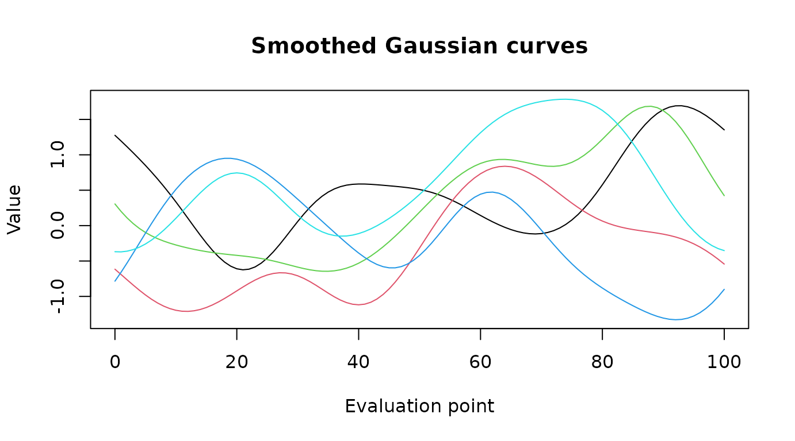

## Compare smoothness on the same noise

To isolate the effect of `fwhm`, generate white noise once and pass the
same matrix to
[`smooth_gaussian_curves()`](https://mr-seydi.github.io/waveform/reference/smooth_gaussian_curves.md)
for each smoothing level. `fwhm` must be a positive finite number. Use
[`gaussian_swn()`](https://mr-seydi.github.io/waveform/reference/gaussian_swn.md)
directly to get unsmoothed curves;
[`smooth_gaussian_curves()`](https://mr-seydi.github.io/waveform/reference/smooth_gaussian_curves.md)
does not accept `fwhm = 0`. As `fwhm` becomes very large relative to the
domain, the smoothed curves approach constant curves.

``` r

set.seed(123)
noise <- gaussian_swn(number_of_curves = 3, num_points = 101)

less_smooth <- smooth_gaussian_curves(noise, mu = 0, sig = 1, fwhm = 5)
more_smooth <- smooth_gaussian_curves(noise, mu = 0, sig = 1, fwhm = 20)

par(mfrow = c(1, 2))
matplot(less_smooth, type = "l", lty = 1, main = "FWHM = 5",
        xlab = "Evaluation point", ylab = "Value")
matplot(more_smooth, type = "l", lty = 1, main = "FWHM = 20",
        xlab = "Evaluation point", ylab = "Value")
```

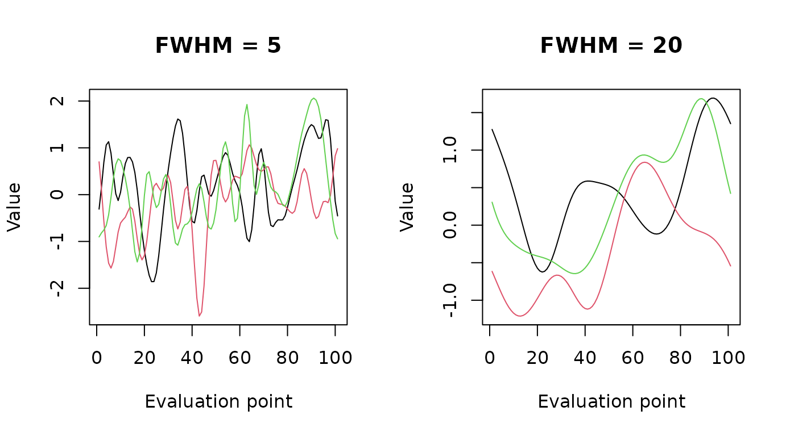

``` r

par(mfrow = c(1, 1))
```

## Create signal shapes

[`gaussian_signal()`](https://mr-seydi.github.io/waveform/reference/gaussian_signal.md),
[`sin_signal()`](https://mr-seydi.github.io/waveform/reference/sin_signal.md),
and
[`cos_signal()`](https://mr-seydi.github.io/waveform/reference/cos_signal.md)
return signal values with their domain.
[`square_signal()`](https://mr-seydi.github.io/waveform/reference/square_signal.md)
returns a vector on the same zero-based domain. These signals can be
plotted or combined with other curves.

``` r

gaussian <- gaussian_signal(
  center = 50, amplitude = 2, sfwhm = 12, num_points = 101
)
sine <- sin_signal(
  num_points = 101, amplitude = 1, frequency = 0.03, phase = 0, offset = 0
)
cosine <- cos_signal(
  num_points = 101, amplitude = 1, frequency = 0.03, phase = 0, offset = 0
)
square <- square_signal(
  start_end_signal = c(20, 60), start_height = 0,
  signal_height = 1, num_points = 101
)

signal_matrix <- cbind(
  Gaussian = gaussian$signal_values,
  Sine = sine$signal_values,
  Cosine = cosine$signal_values,
  Square = square
)
matplot(gaussian$domain, signal_matrix, type = "l", lty = 1:4,
        xlab = "Evaluation point", ylab = "Value", main = "Signal shapes")
legend("topright", legend = colnames(signal_matrix), lty = 1:4)
```

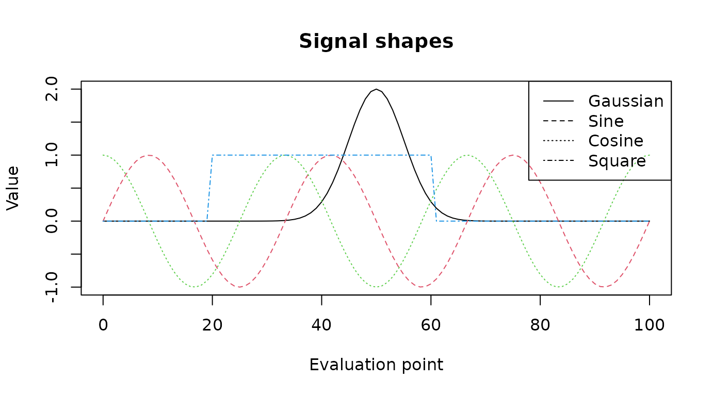

## Estimate smoothness

[`estimate_fwhm()`](https://mr-seydi.github.io/waveform/reference/estimate_fwhm.md)
estimates residual-field smoothness. For observations $`Y_{ig}(t)`$ in
group $`g`$, the residual functions are

``` math
\hat r_{ig}(t) = Y_{ig}(t) - \hat\mu_g(t),
```

where $`g\in\{1,2\}`$, $`i=1,\ldots,n_g`$, and $`\hat\mu_g(t)`$ is the
estimated group mean function. At each point, the residual and
derivative sums of squares are

``` math
SS_{r}(t) = \sum_g \sum_i \hat r_{ig}(t)^2,
\qquad
SS_{r'}(t) = \sum_g \sum_i \left(\hat r'_{ig}(t)\right)^2,
\qquad
\hat r'_{ig}(t) = \frac{d\hat r_{ig}(t)}{dt}.
```

The local derivative ratio and local FWHM are

``` math
\hat\lambda(t) = \frac{SS_{r'}(t)}{SS_{r}(t)},
\qquad
\widehat{\mathrm{FWHM}}(t) =
\sqrt{\frac{4\ln 2}{\hat\lambda(t)}}.
```

The implementation approximates derivatives with finite differences on a
unit-spaced domain. It reports the global estimate as the reciprocal of
the mean resels per node:

``` math
\widehat{\mathrm{FWHM}} =
\left[\frac{1}{|T^*|}\sum_{t\in T^*}
\sqrt{\frac{\hat\lambda(t)}{4\ln 2}}\right]^{-1},
```

where $`T^*`$ contains points with nonzero residual sum of squares.
Residual smoothness is relevant to inference on one-dimensional
trajectories; see Pataky, Vanrenterghem, and Robinson (2016) ([Pataky et
al. 2016](#ref-pataky2016)). For one group,
[`estimate_fwhm()`](https://mr-seydi.github.io/waveform/reference/estimate_fwhm.md)
centers the supplied curves pointwise. For multiple groups, provide
residual curves after centering within each group.

``` r

estimated_fwhm <- estimate_fwhm(R = generated$curves)
estimated_fwhm
#> [1] 17.46428
```

## Change the evaluation grid

[`dense_data()`](https://mr-seydi.github.io/waveform/reference/dense_data.md)
fits the curves with an `fda` B-spline basis and evaluates them on a new
grid. The new grid can have more or fewer points than the input grid.

``` r

dense_200 <- dense_data(data = generated$curves, num_evaluation = 200)
dense_50 <- dense_data(data = generated$curves, num_evaluation = 50)
dim(dense_200)
#> [1] 200   5
dim(dense_50)
#> [1] 50  5
```

Each output is evaluated across the same domain as the original curves.
The following figure compares the original, 200-point, and 50-point
evaluation grids in three vertically stacked panels. Each panel shows
all five curves over the same domain and uses the same vertical scale.

``` r

domain_original <- seq(
  from = 0,
  to = nrow(generated$curves) - 1,
  length.out = nrow(generated$curves)
)
domain_200 <- seq(
  from = 0,
  to = nrow(generated$curves) - 1,
  length.out = nrow(dense_200)
)
domain_50 <- seq(
  from = 0,
  to = nrow(generated$curves) - 1,
  length.out = nrow(dense_50)
)

curve_colors <- grDevices::hcl.colors(ncol(generated$curves), "Dark 3")
plot_ylim <- range(generated$curves, dense_200, dense_50)
par(mfrow = c(3, 1), mar = c(2.5, 4, 2, 1))

matplot(domain_original, generated$curves, type = "b", pch = 16, cex = 0.5,
        lty = 1, col = curve_colors, xlim = range(domain_original),
        ylim = plot_ylim, xlab = "", ylab = "Value",
        main = "Original: 101 points")
matplot(domain_200, dense_200, type = "l", lty = 1,
        col = curve_colors, xlim = range(domain_original),
        ylim = plot_ylim, xlab = "", ylab = "Value",
        main = "Dense: 200 points")
matplot(domain_50, dense_50, type = "l", lty = 1,
        col = curve_colors, xlim = range(domain_original),
        ylim = plot_ylim, xlab = "Evaluation point", ylab = "Value",
        main = "Sparse: 50 points")
```

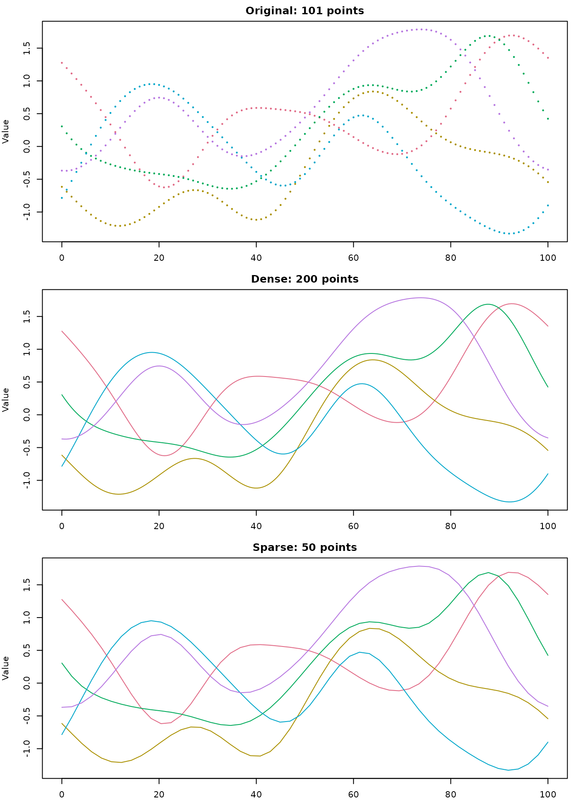

``` r

par(mfrow = c(1, 1))
```

## Practical example: simulation studies

The following studies illustrate applications in which functional
trajectories are analyzed or simulated under different signal and noise
characteristics:

- Seydi et al.’s sample-size study uses medical waveforms and
  simulations that vary noise characteristics and mean-difference
  patterns ([Seydi, Strandberg, et al. 2026](#ref-seydi2026sample)).
- Their power study examines how noise smoothness and effect-trajectory
  characteristics influence statistical power for biomechanical
  trajectories ([Seydi, Pataky, et al. 2026](#ref-seydi2026influence)).

### Build a two-group simulation step by step

A general two-group simulation can be written as

``` math
Y_{ig}(t) = \mu_0(t) + \delta_g(t) + \epsilon_{ig}(t),
```

where $`\mu_0(t)`$ is a baseline signal, $`\delta_g(t)`$ is the
group-specific effect, and $`\epsilon_{ig}(t)`$ is random noise. The
signal shape, effect pattern, noise standard deviation, and noise FWHM
can each be varied to build different scenarios.

#### Step 1: Create the baseline signal

Combine a Gaussian peak and a low-amplitude sine component to define a
baseline waveform.

``` r

practical_num_points <- 101
practical_domain <- seq(0, practical_num_points - 1)

baseline_peak <- gaussian_signal(
  center = 45, amplitude = 2, sfwhm = 16,
  num_points = practical_num_points
)
baseline_oscillation <- sin_signal(
  num_points = practical_num_points,
  amplitude = 0.25, frequency = 0.02, phase = 0, offset = 0
)
baseline_signal <- baseline_peak$signal_values +
  baseline_oscillation$signal_values

plot(practical_domain, baseline_signal, type = "l", lwd = 2,
     xlab = "Evaluation point", ylab = "Signal",
     main = "Step 1: Baseline signal")
```


#### Step 2: Define a group effect

Use a square signal to represent an effect that is active only over a
selected part of the domain. Plot the two group means before adding
noise.

``` r

group_effect <- square_signal(
  start_end_signal = c(35, 65), start_height = 0,
  signal_height = 0.8, num_points = practical_num_points
)
group1_mean <- baseline_signal
group2_mean <- baseline_signal + group_effect

matplot(practical_domain, cbind(Control = group1_mean, Effect = group2_mean),
        type = "l", lty = 1:2, lwd = 2, col = c("steelblue", "firebrick"),
        xlab = "Evaluation point", ylab = "Mean signal",
        main = "Step 2: Group means and effect")
legend("topright", legend = c("Control", "Effect group"),
       col = c("steelblue", "firebrick"), lty = 1:2, lwd = 2, bty = "n")
```

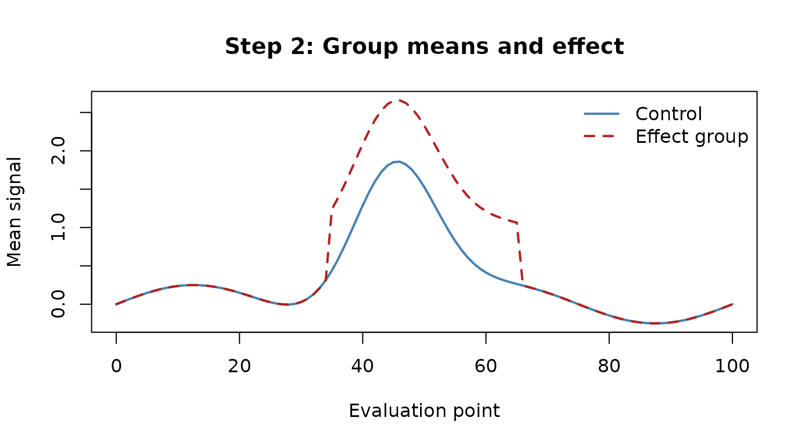

#### Step 3: Generate unsmoothed noise

Generate five independent noise curves for each group and plot the raw
white noise before smoothing.

``` r

set.seed(321)
practical_sample_size <- 5
raw_noise <- gaussian_swn(
  number_of_curves = 2 * practical_sample_size,
  num_points = practical_num_points
)

matplot(practical_domain, raw_noise, type = "l", lty = 1,
        col = "grey55", xlab = "Evaluation point", ylab = "Noise",
        main = "Step 3: Unsmoothed Gaussian noise")
```

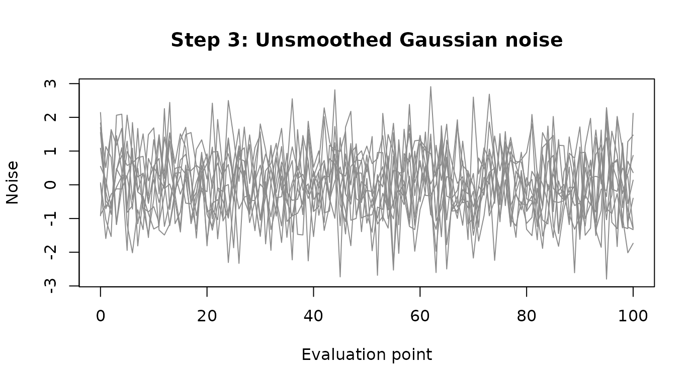

#### Step 4: Smooth and scale the noise

Apply the same smoothing FWHM and standard deviation to each noise
curve.

``` r

smooth_noise <- smooth_gaussian_curves(
  data = raw_noise, mu = 0, sig = 0.4, fwhm = 8
)

matplot(practical_domain, smooth_noise, type = "l", lty = 1,
        col = "grey45", xlab = "Evaluation point", ylab = "Noise",
        main = "Step 4: Smoothed Gaussian noise (FWHM = 8)")
```

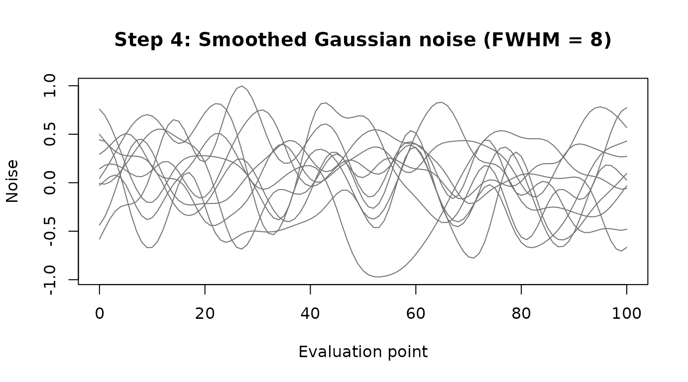

#### Alternative: generate smoothed noise directly

This call combines Gaussian noise generation and smoothing in one step.
It returns a list, so use its `$curves` component for matrix operations.
This alternative replaces Steps 3 and 4; Step 5 uses this matrix below.

``` r

generated_smooth_noise <- gaussian_curves_generator(
  sample_size = 2 * practical_sample_size,
  num_points = practical_num_points,
  mu = 0,
  sig = 0.4,
  fwhm = 8
)
smooth_noise <- generated_smooth_noise$curves

matplot(practical_domain, smooth_noise, type = "l", lty = 1,
        col = "grey45", xlab = "Evaluation point", ylab = "Noise",
        main = "Smoothed Gaussian noise (FWHM = 8)")
```

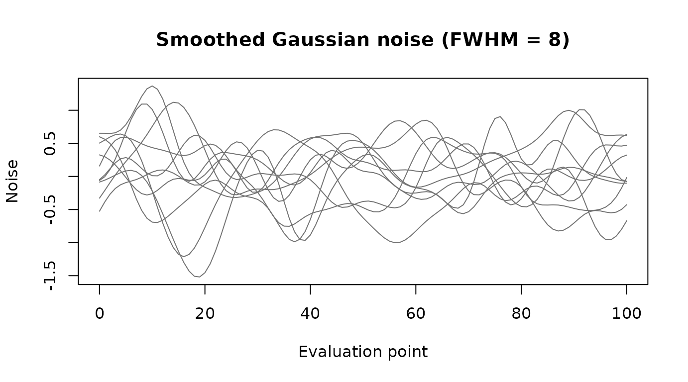

#### Step 5: Add noise to the group signals

Combine the signals and smoothed noise to obtain the simulated data
matrix. Rows are evaluation points and columns are curves.

``` r

group1_columns <- seq_len(practical_sample_size)
group2_columns <- practical_sample_size + seq_len(practical_sample_size)

group1_data <- sweep(
  smooth_noise[, group1_columns, drop = FALSE], 1, group1_mean, "+"
)
group2_data <- sweep(
  smooth_noise[, group2_columns, drop = FALSE], 1, group2_mean, "+"
)
simulated_data <- cbind(group1_data, group2_data)

plot(NA, xlim = range(practical_domain),
     ylim = range(simulated_data, group1_mean, group2_mean),
     xlab = "Evaluation point", ylab = "Observed value",
     main = "Step 5: Simulated functional data")
matlines(practical_domain, group1_data, col = "steelblue", lty = 1)
matlines(practical_domain, group2_data, col = "firebrick", lty = 1)
lines(practical_domain, group1_mean, col = "navy", lwd = 3)
lines(practical_domain, group2_mean, col = "darkred", lwd = 3)
legend("topright",
       legend = c("Control curves", "Effect-group curves",
                  "Control mean", "Effect-group mean"),
       col = c("steelblue", "firebrick", "navy", "darkred"),
       lty = 1, lwd = c(1, 1, 3, 3), bty = "n")
```

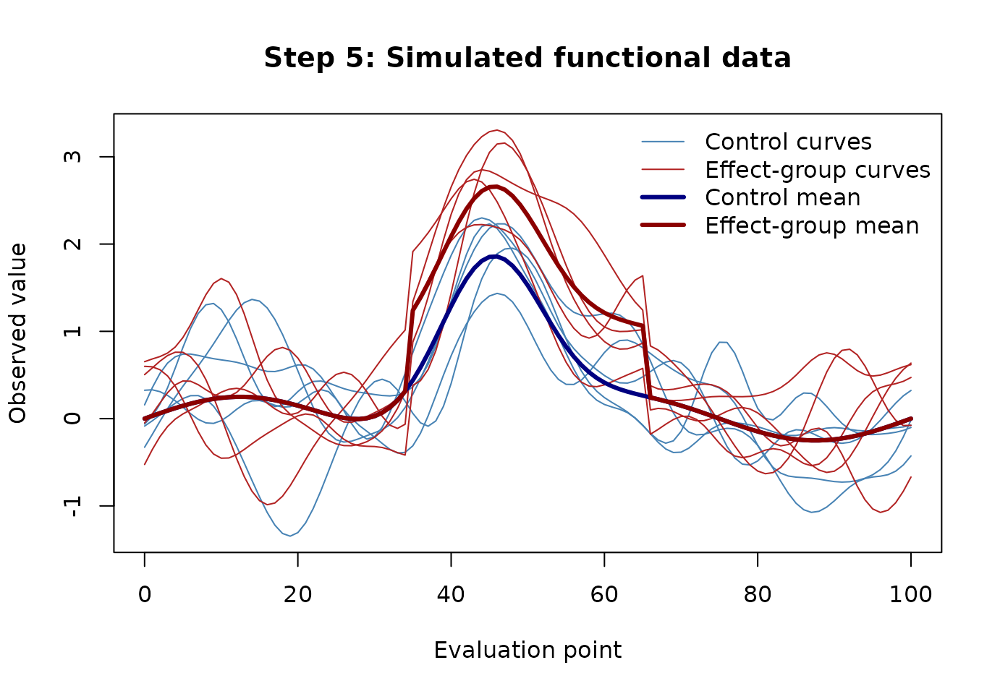

The resulting `simulated_data` matrix can be passed to downstream
functional analyses.

## Example data: thorax obliquity during walking

The package includes two sets of functional curves describing thorax
obliquity (upward and downward trunk motion) during walking: `male`
contains curves from 65 male participants and `female` contains curves
from 71 female participants. Both matrices have 101 rows, representing
the common evaluation grid, and one column per participant. These data
come from the publicly available full-body gait dataset described by Van
Criekinge et al. (2023) ([Van Criekinge et al. 2023](#ref-van2023full)).
See [`?male`](https://mr-seydi.github.io/waveform/reference/male.md) and
[`?female`](https://mr-seydi.github.io/waveform/reference/female.md) for
details and the source.

The following plot overlays all participant curves, using color to
distinguish the two groups. The horizontal axis indexes the 101 points
on the common grid.

``` r

data("male", package = "waveform")
data("female", package = "waveform")

evaluation_grid <- seq(0, 100, length.out = 101)
male_color <- grDevices::adjustcolor("#2878B5", alpha.f = 0.35)
female_color <- grDevices::adjustcolor("#D1495B", alpha.f = 0.35)

matplot(
  x = evaluation_grid,
  y = male,
  type = "l",
  lty = 1,
  col = male_color,
  xlab = "Evaluation point",
  ylab = "Thorax obliquity",
  main = "Thorax obliquity curves by participant"
)
matlines(
  x = evaluation_grid,
  y = female,
  type = "l",
  lty = 1,
  col = female_color
)
legend(
  "topright",
  legend = c("Male participants", "Female participants"),
  col = c("#2878B5", "#D1495B"),
  lty = 1,
  lwd = 2,
  bty = "n"
)
```

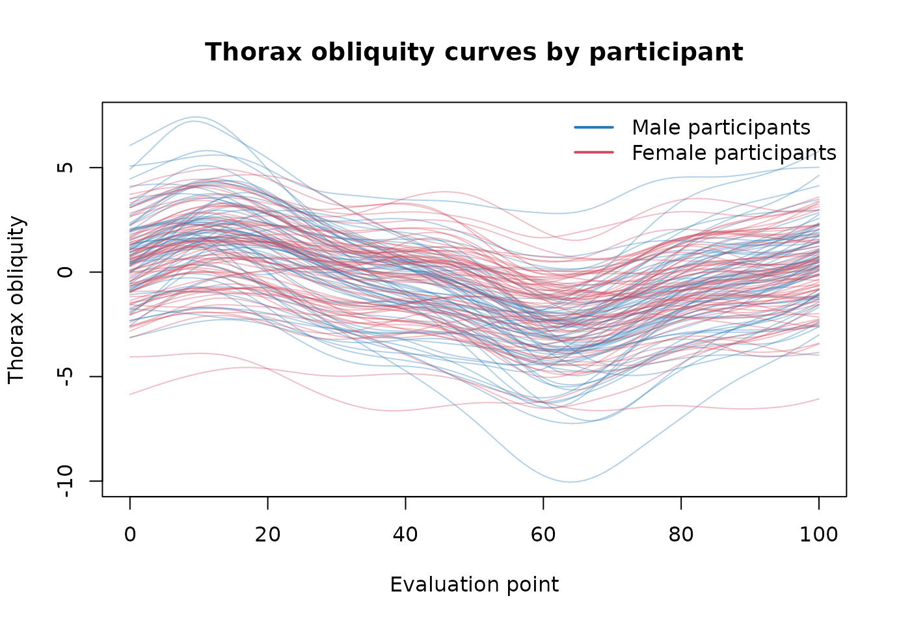

These observed curves provide an example of the kind of functional data
we want to represent with simulations. The package’s generators let us
create curves with controlled signals, noise, and smoothness so that
simulated data can reflect key characteristics of these original data.

## Practical example: simulation based on real data

In this section, we want to simulate thorax data that reflect the key
characteristics of these original data for male and female.

#### Step 1: Estimate the parameters

First, estimate each group’s mean function and subtract it from the
observed curves to obtain residuals. Estimate the residual FWHM and the
pointwise residual standard deviation separately for each group.

``` r

residuals_male <- sweep(male, 1, rowMeans(male), FUN = "-")
residuals_female <- sweep(female, 1, rowMeans(female), FUN = "-")

fwhm_male <- estimate_fwhm(residuals_male)
fwhm_female <- estimate_fwhm(residuals_female)

fwhm_male
#> [1] 47.08095
fwhm_female
#> [1] 59.08177

sd_male <- apply(residuals_male, 1, sd)
sd_female <- apply(residuals_female, 1, sd)

mean_male <- rowMeans(male)
mean_female <- rowMeans(female)
```

The left panel shows the group mean functions. The right panel shows the
within-group residual functions after subtracting those means.

``` r

par(mfrow = c(1, 2), mar = c(4, 4, 3, 1))

matplot(
  evaluation_grid, cbind(Male = mean_male, Female = mean_female),
  type = "l", lty = 1, lwd = 2, col = c("#2878B5", "#D1495B"),
  xlab = "Evaluation point", ylab = "Mean thorax obliquity",
  main = "Estimated group means"
)
legend("topright", legend = c("Male", "Female"),
       col = c("#2878B5", "#D1495B"), lty = 1, lwd = 2, bty = "n")

plot(
  NA, xlim = range(evaluation_grid),
  ylim = range(residuals_male, residuals_female),
  xlab = "Evaluation point", ylab = "Residual thorax obliquity",
  main = "Residual functions"
)
matlines(evaluation_grid, residuals_male, col =
           grDevices::adjustcolor("#2878B5", alpha.f = 0.18), lty = 1)
matlines(evaluation_grid, residuals_female, col =
           grDevices::adjustcolor("#D1495B", alpha.f = 0.18), lty = 1)
legend("topright", legend = c("Male", "Female"),
       col = c("#2878B5", "#D1495B"), lty = 1, lwd = 2, bty = "n")
```

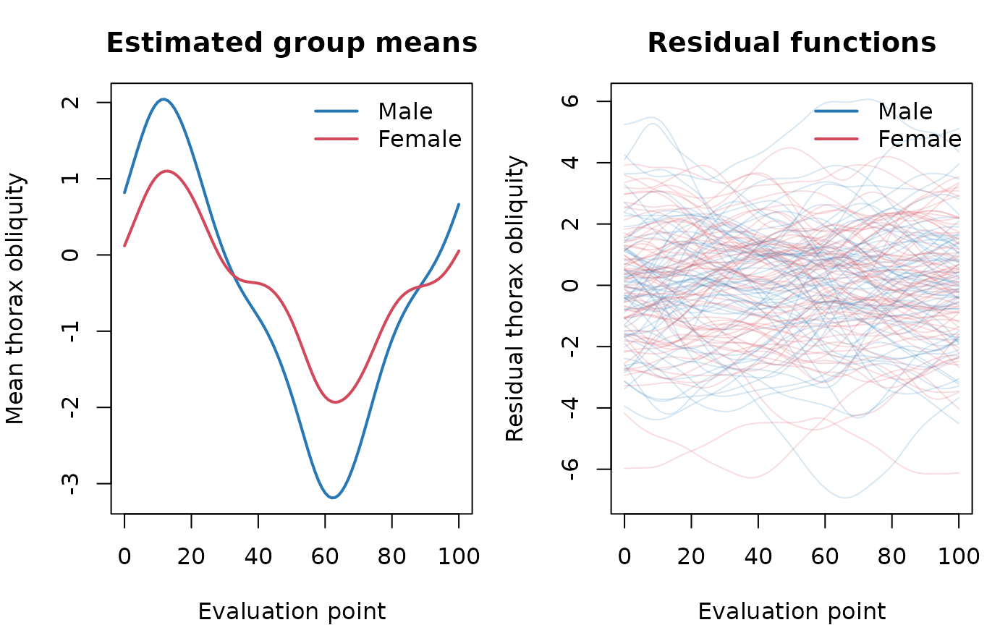

``` r


par(mfrow = c(1, 1))
```

#### Step 2: Simulation model

Consider
``` math
y_{ig}(t) = \mu_g(t) + \epsilon_{ig}(t),
```

where $`\mu_g(t)`$ is the group-specific mean functions, and
$`\epsilon_{ig}(t)`$ is random noise for individual $`i=1,..,n`$. Here,
$`n`$ denotes the sample size.

#### Step 3: Generate noise functions

Generate 20 curves per group. The estimated pointwise residual standard
deviations are passed as `sig`, and each group’s estimated residual FWHM
is passed as `fwhm`. A fixed seed makes the simulated noise
reproducible.

``` r

set.seed(12345)

n <- 20
num_point_domain <- nrow(male)

noise_male <- gaussian_curves_generator(
  sample_size = n, num_points = num_point_domain,
  mu = 0, sig = sd_male, fwhm = fwhm_male
)

noise_female <- gaussian_curves_generator(
  sample_size = n, num_points = num_point_domain,
  mu = 0, sig = sd_female, fwhm = fwhm_female
)
```

The generated noise curves use the estimated smoothness and pointwise
variability for each group.

``` r

par(mfrow = c(1, 2), mar = c(4, 4, 3, 1))
matplot(
  evaluation_grid, noise_male$curves, type = "l", lty = 1,
  col = grDevices::adjustcolor("#2878B5", alpha.f = 0.6),
  xlab = "Evaluation point", ylab = "Noise", main = "Male noise curves"
)
abline(h = 0, col = "grey50", lty = 2)
matplot(
  evaluation_grid, noise_female$curves, type = "l", lty = 1,
  col = grDevices::adjustcolor("#D1495B", alpha.f = 0.6),
  xlab = "Evaluation point", ylab = "Noise", main = "Female noise curves"
)
abline(h = 0, col = "grey50", lty = 2)
```

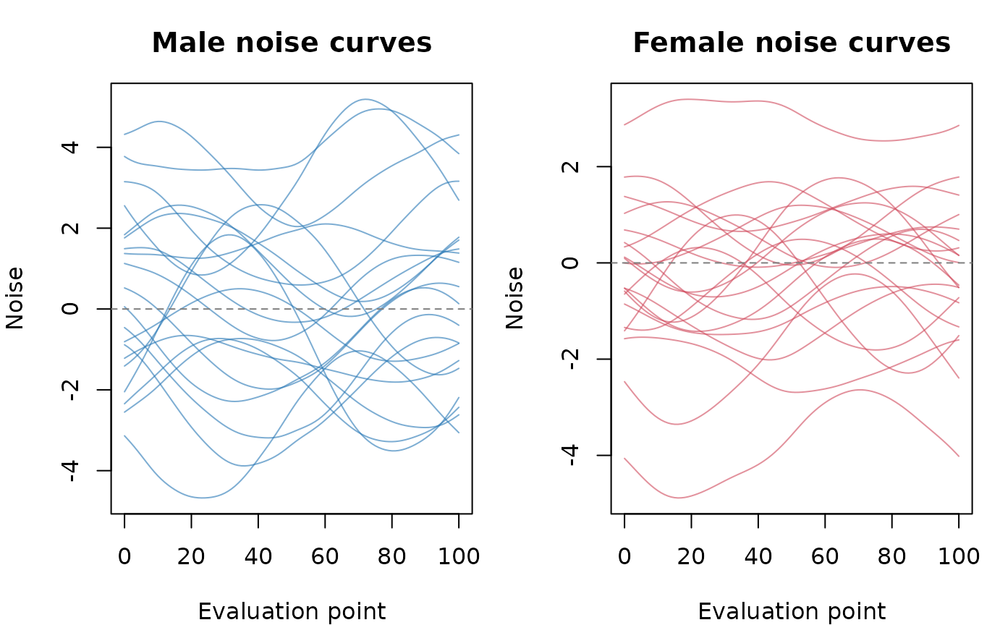

``` r

par(mfrow = c(1, 1))
```

#### Step 4: Simulate observations

Add each simulated noise curve to its group’s estimated mean function.
The resulting matrices have evaluation points in rows and simulated
participants in columns.

``` r

simulated_male <- sweep(noise_male$curves, 1, mean_male, FUN = "+")
simulated_female <- sweep(noise_female$curves, 1, mean_female, FUN = "+")

dim(simulated_male)
#> [1] 101  20
dim(simulated_female)
#> [1] 101  20
```

#### Step 5: Compare original and simulated data

The two panels below show the original participant curves and the
simulated curves, respectively. Both panels use the same domain and
vertical scale; color distinguishes the male and female groups.

``` r

comparison_ylim <- range(male, female, simulated_male, simulated_female)
male_color <- grDevices::adjustcolor("#2878B5", alpha.f = 0.25)
female_color <- grDevices::adjustcolor("#D1495B", alpha.f = 0.25)

par(mfrow = c(1, 2), mar = c(4, 4, 3, 1))

plot(
  NA, xlim = range(evaluation_grid), ylim = comparison_ylim,
  xlab = "Evaluation point", ylab = "Thorax obliquity",
  main = "Original data"
)
matlines(evaluation_grid, male, col = male_color, lty = 1)
matlines(evaluation_grid, female, col = female_color, lty = 1)
legend("topright", legend = c("Male", "Female"),
       col = c("#2878B5", "#D1495B"), lty = 1, lwd = 2, bty = "n")

plot(
  NA, xlim = range(evaluation_grid), ylim = comparison_ylim,
  xlab = "Evaluation point", ylab = "Thorax obliquity",
  main = "Simulated data (n = 20)"
)
matlines(evaluation_grid, simulated_male, col = male_color, lty = 1)
matlines(evaluation_grid, simulated_female, col = female_color, lty = 1)
legend("topright", legend = c("Male curves", "Female curves"),
       col = c("#2878B5", "#D1495B"), lty = 1, lwd = 2, bty = "n")
```

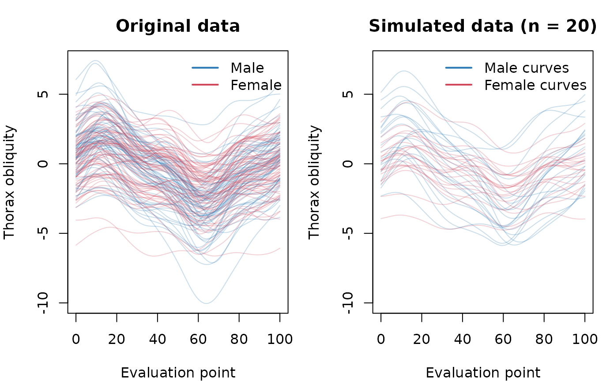

``` r


par(mfrow = c(1, 1))
```

This simulation matches the observed group means, pointwise residual
standard deviations, and estimated residual FWHM.

## Further information

See the function help pages for argument details and additional
examples, for example
[`?gaussian_curves_generator`](https://mr-seydi.github.io/waveform/reference/gaussian_curves_generator.md),
[`?estimate_fwhm`](https://mr-seydi.github.io/waveform/reference/estimate_fwhm.md),
and
[`?dense_data`](https://mr-seydi.github.io/waveform/reference/dense_data.md).

## References

Pataky, Todd C., Jos Vanrenterghem, and Mark A. Robinson. 2016. “The
Probability of False Positives in Zero-Dimensional Analyses of
One-Dimensional Kinematic, Force and EMG Trajectories.” *Journal of
Biomechanics* 49 (9): 1468–76.
<https://doi.org/10.1016/j.jbiomech.2016.03.032>.

Seydi, Mohammad Reza, Todd C. Pataky, Johan Strandberg, and Lina
Schelin. 2026. “Influence of Noise and Effect Characteristics on
Statistical Power in the Analyses of One-Dimensional Biomechanical
Trajectories.” *Journal of Biomechanics* 201: 113281.
<https://doi.org/10.1016/j.jbiomech.2026.113281>.

Seydi, Mohammad Reza, Johan Strandberg, Todd C. Pataky, and Lina
Schelin. 2026. “Sample Size Estimation for Local Hypothesis Testing of
Functional Data in Medical Studies: Method Comparison, Recommendations,
and a Web Application.” *BMC Medical Research Methodology* 26 (1): 19.
<https://doi.org/10.1186/s12874-026-02772-w>.

Van Criekinge, Tamaya, Wim Saeys, Steven Truijen, Luc Vereeck, Lizeth H.
Sloot, and Ann Hallemans. 2023. “A Full-Body Motion Capture Gait Dataset
of 138 Able-Bodied Adults Across the Life Span and 50 Stroke Survivors.”
*Scientific Data* 10 (1): 852.
<https://doi.org/10.1038/s41597-023-02767-y>.
